# Task 1 — Multi-Container Pods (Init Container & Sidecar)

**Kubernetes: Beginner to Mastery | MLOps MENA Community**

## 1. Overview

This task deploys an Nginx Hello webpage on a **three-node Minikube cluster** using a Kubernetes Deployment with three replicas.

Each Pod uses an init container, a main Nginx container, and a time-updater sidecar. The sidecar updates the webpage's timestamp every five seconds without using shared volumes.

The task also demonstrates Kubernetes Pod initialization failures, `Init:CrashLoopBackOff`, RollingUpdate availability, and successful recovery.

### Expected webpage

```text
hello in MLOPS MENA COMMUNITY : YYYY-MM-DD HH:MM:SS
```

## 2. Environment

| Component | Configuration |
|---|---|
| Host OS | Ubuntu 22.04 LTS |
| Docker Engine | 29.9.3 |
| Minikube | 1.39.0 |
| Kubernetes | 1.35.0 |
| Container Runtime | containerd 2.3.4 |
| Cluster | 1 control-plane node and 2 worker nodes |
| Network Plugin | Calico |
| Namespace | `webapp` |
| Deployment | `web-deployment` |
| Replicas | 3 |
| Pod Label | `app: web` |

### Cluster nodes

- `minikube` — Control Plane
- `minikube-m02` — Worker
- `minikube-m03` — Worker

All three nodes reached `Ready`.

## 3. Pod Architecture

```text
3-Node Minikube Cluster
         |
         v
Namespace: webapp
         |
         v
Deployment: web-deployment
         |
         v
ReplicaSet (3 replicas)
         |
         +-- Pod 1
         +-- Pod 2
         +-- Pod 3

Each Pod:
+-------------------------------------+
| shareProcessNamespace: true         |
|                                     |
| init-done (busybox:1.36)            |
|   |                                 |
|   +-- echo done                     |
|   +-- exit 0                        |
|                                     |
| nginx (nginx:1.27)                  |
|   +-- creates index.html            |
|   +-- serves webpage on port 80     |
|                                     |
| time-updater (busybox:1.36)         |
|   +-- finds Nginx process PID       |
|   +-- accesses /proc/PID/root       |
|   +-- updates HTML every 5 seconds  |
|                                     |
| No Pod volumes                      |
+-------------------------------------+
```

### Container responsibilities

| Container | Role | Function |
|---|---|---|
| `init-done` | Init Container | Prints `done` and exits successfully |
| `nginx` | Main Container | Creates and serves the initial HTML webpage |
| `time-updater` | Sidecar | Rewrites the webpage timestamp every five seconds |

The Pod uses `shareProcessNamespace: true`, allowing the sidecar to find the Nginx process.

The sidecar accesses Nginx's filesystem through:

```text
/proc/<nginx-pid>/root/usr/share/nginx/html/index.html
```

The sidecar has the `SYS_PTRACE` capability required for the process-access mechanism used in this lab.

No application volumes are defined, and automatic ServiceAccount token mounting is disabled.

## 4. Project Files

```text
Task-1/
├── namespace.yaml
├── deployment.yaml
├── deployment-failing.yaml
├── README.md
└── screenshots/
    ├── 01-deployment-success.png
    ├── 02-webpage-before.png
    ├── 03-webpage-after.png
    ├── 04-sidecar-process-sharing.png
    ├── 05-no-volumes-verification.png
    ├── 06-cluster-nodes-and-pods.png
    ├── 07-init-container-success.png
    ├── 08-init-crashloopbackoff.png
    ├── 09-init-failure-diagnosis.png
    ├── 10-zero-downtime-verification.png
    └── 11-deployment-recovery.png
```

`deployment.yaml` contains the working configuration.

`deployment-failing.yaml` contains the intentionally failing init-container configuration used for testing.

## 5. Cluster Setup

Create the three-node cluster with Calico:

```bash
minikube start \
  --driver=docker \
  --nodes=3 \
  --cni=calico \
  --cpus=2 \
  --memory=2200 \
  --kubernetes-version=v1.35.0
```

Verify the nodes and system Pods:

```bash
kubectl get nodes -o wide
kubectl get pods -n kube-system
```

**Result:** All three nodes were Ready, and Calico, CoreDNS, and other system components became healthy.

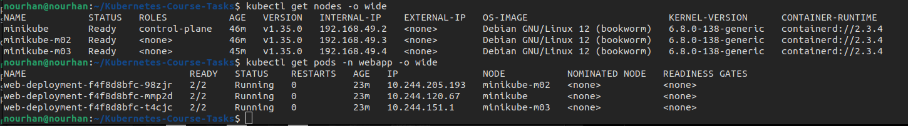

## 6. Deploy the Application

Create the namespace:

```bash
kubectl apply -f namespace.yaml
```

Validate the working Deployment:

```bash
kubectl apply --dry-run=server -f deployment.yaml
```

Apply the Deployment:

```bash
kubectl apply -f deployment.yaml
```

Verify the Deployment, ReplicaSet, and Pods:

```bash
kubectl get deployments -n webapp
kubectl get replicasets -n webapp
kubectl get pods -n webapp -o wide
```

### Results

- Deployment READY: `3/3`
- Up-to-date replicas: `3`
- Available replicas: `3`
- All three Pods: `2/2 Running`
- Container restarts: `0`
- One Pod was scheduled on each node during the experiment.

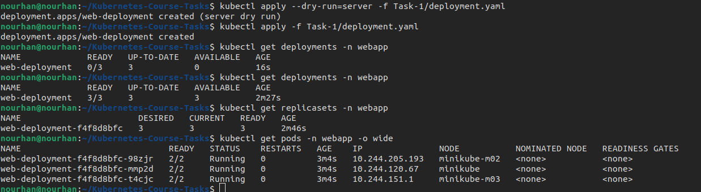

## 7. Verify the Init Container

Inspect the successful init-container logs:

```bash
kubectl logs deployment/web-deployment -n webapp -c init-done
```

Output:

```text
done
```

Inspect the init-container termination status:

```text
Reason: Completed
Exit Code: 0
```

This confirms the init container finished successfully before the regular application containers started.

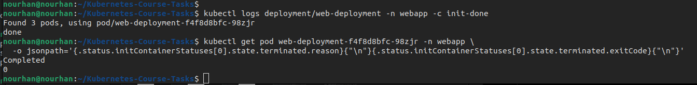

## 8. Verify the Nginx Webpage

Forward local port 8080 to Nginx:

```bash
kubectl port-forward -n webapp deployment/web-deployment 8080:80
```

Open:

**http://localhost:8080**

The webpage displays:

```text
hello in MLOPS MENA COMMUNITY : <current timestamp>
```

The timestamp changes when the webpage is refreshed after the sidecar's five-second update interval.

The timestamp uses the container's configured timezone, which may differ from the host machine's local timezone.

### Timestamp evidence

**Before:**

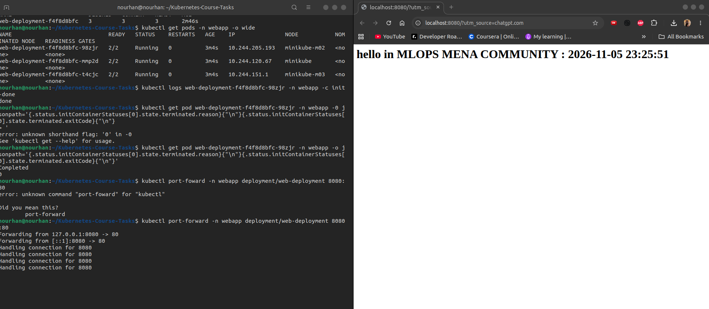

**After:**

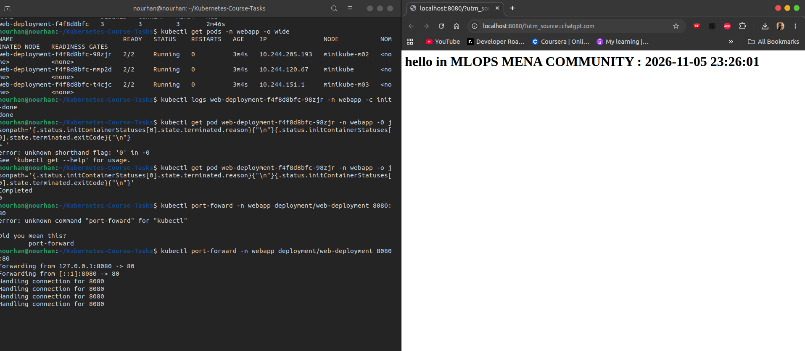

## 9. Verify Sidecar Process Sharing

Inspect processes from inside the sidecar:

```bash
kubectl exec -n webapp \
  deployment/web-deployment \
  -c time-updater -- ps
```

The output included:

```text
PID 1    /pause
PID 13   nginx: master process
PID 28   sh -c while true; do ...
```

The sidecar could see both the Nginx process and its own update process.

To verify filesystem access through `/proc`, the sidecar identified the Nginx PID and read:

```text
/proc/13/root/usr/share/nginx/html/index.html
```

The file contained the expected Hello message and timestamp.

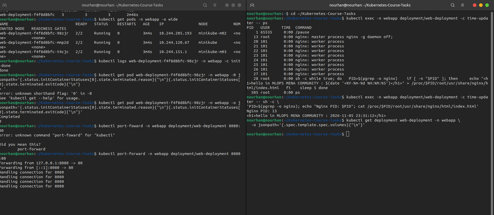

### No-volume verification

```bash
kubectl get deployment web-deployment -n webapp \
  -o jsonpath='{.spec.template.spec.volumes}{"\n"}'
```

The command produced an empty result, confirming that no volumes were defined in the Pod template.

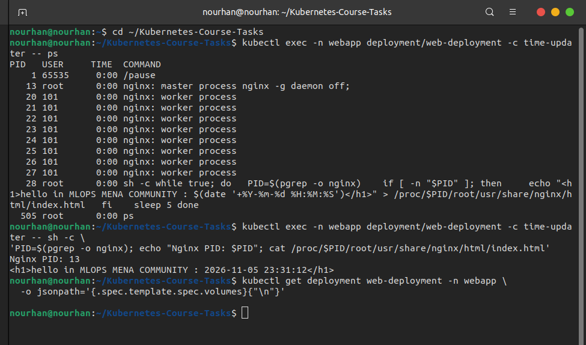

## 10. Intentionally Fail the Init Container

The successful init-container command is:

```yaml
command:
  - sh
  - -c
  - echo done
```

In `deployment-failing.yaml`, it was changed to:

```yaml
command:
  - sh
  - -c
  - echo 'init failed'; exit 1
```

Apply the failing configuration:

```bash
kubectl apply -f deployment-failing.yaml
```

Observe the Pods:

```bash
kubectl get pods -n webapp -l app=web -w
```

### Observed result

Kubernetes created one new Pod with readiness `0/2`.

The Pod repeatedly transitioned through:

```text
Init:Error
Init:CrashLoopBackOff
```

Meanwhile, the original three Pods remained:

```text
2/2 Running
2/2 Running
2/2 Running
```

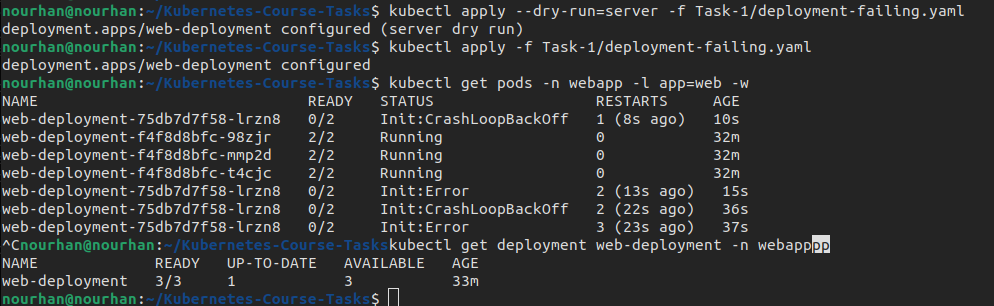

## 11. Diagnose the Failure

Inspect the failing init-container logs:

```bash
kubectl logs <failing-pod> -n webapp -c init-done
```

Output:

```text
init failed
```

Inspect the Pod:

```bash
kubectl describe pod <failing-pod> -n webapp
```

The init container reported:

```text
Reason: Error
Exit Code: 1
Ready: False
```

Repeated init-container failures caused Kubernetes to retry the container with restart backoff.

Because the init container never completed successfully, Nginx and the time-updater could not start in the new Pod.

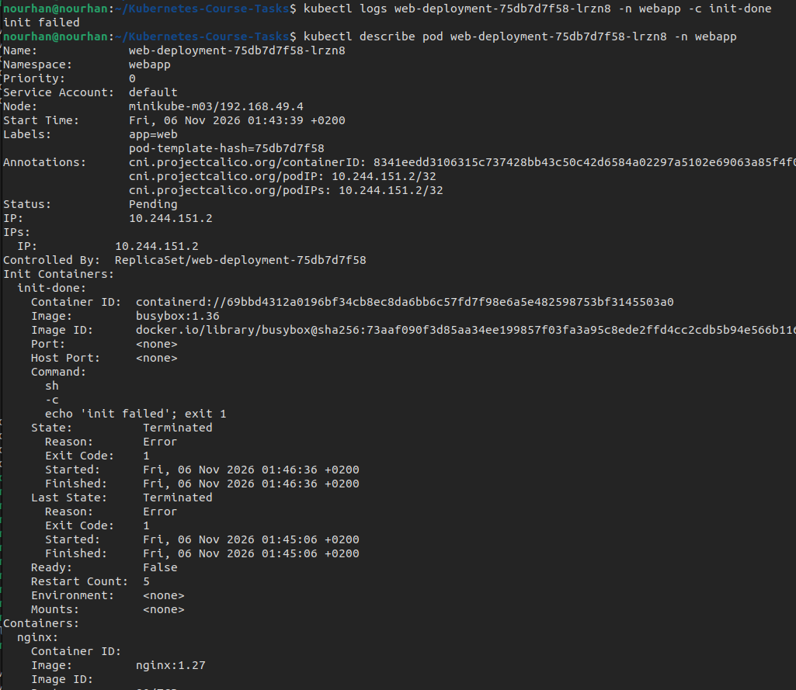

## 12. Verify Application Availability During Failure

The Deployment was configured with:

```yaml
strategy:
  type: RollingUpdate
  rollingUpdate:
    maxSurge: 1
    maxUnavailable: 0
```

During the failed rollout, the Deployment reported:

```text
READY   UP-TO-DATE   AVAILABLE
3/3     1            3
```

This demonstrated that the original three replicas remained available while the new Pod failed.

The original Nginx webpage continued responding successfully:

```bash
curl -fsS http://localhost:8080
```

The command returned the expected HTML with a timestamp.

This provides evidence that the service remained reachable during the observed failure experiment.

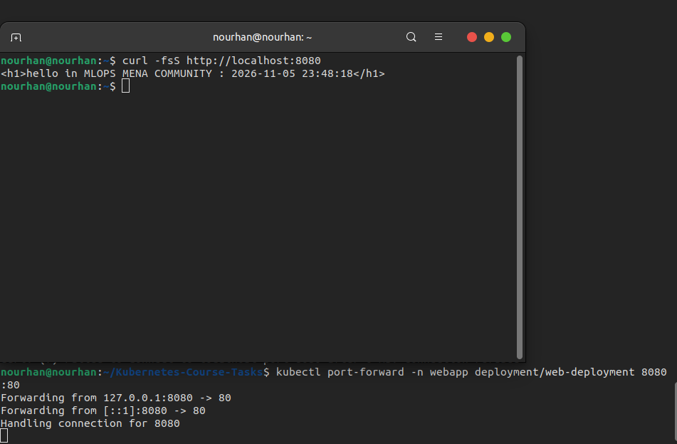

## 13. Recover the Deployment

Restore the successful configuration:

```bash
kubectl apply -f deployment.yaml
```

Verify the rollout:

```bash
kubectl rollout status deployment/web-deployment \
  -n webapp --timeout=120s
```

Output:

```text
deployment "web-deployment" successfully rolled out
```

Verify Deployment health:

```bash
kubectl get deployments -n webapp
kubectl get pods -n webapp
```

### Recovery results

- Deployment READY: `3/3`
- Up-to-date replicas: `3`
- Available replicas: `3`
- All three Pods: `2/2 Running`
- Container restarts: `0`
- Failed replacement Pod removed
- Init-container logs returned `done`
- Nginx webpage responded successfully

Kubernetes reused the existing healthy ReplicaSet when the original Pod template was restored.

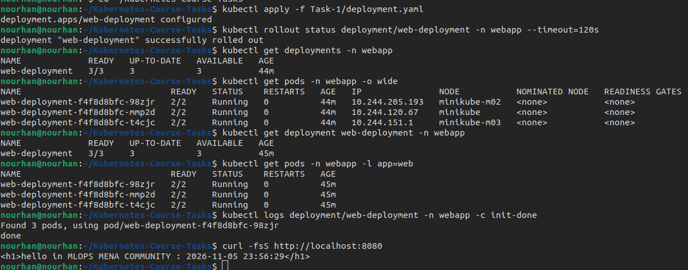

## 14. Key Learnings

1. **Init container sequencing:** The regular application containers start only after their required init containers complete successfully.
2. **Sidecar pattern:** A supporting container can work alongside the main application to provide additional functionality.
3. **Shared process namespace:** Containers in a Pod can observe each other's processes when `shareProcessNamespace` is enabled.
4. **No-volume filesystem access:** The sidecar can access another container's filesystem through `/proc/<pid>/root` under the required permissions.
5. **Pod lifecycle:** An init-container failure can cause repeated restarts and `Init:CrashLoopBackOff`.
6. **Rolling Updates:** `maxSurge: 1` and `maxUnavailable: 0` help preserve available replicas during an unsuccessful rollout.
7. **Kubernetes recovery:** Reapplying a previously working configuration can restore a healthy Deployment.

## 15. Final Outcome

**Task 1 completed successfully.**

The application was deployed across a three-node Minikube cluster, served a timestamped Nginx webpage, demonstrated sidecar process sharing without volumes, reproduced a failing init container, preserved the existing available replicas during the failed rollout, and recovered successfully afterward.
