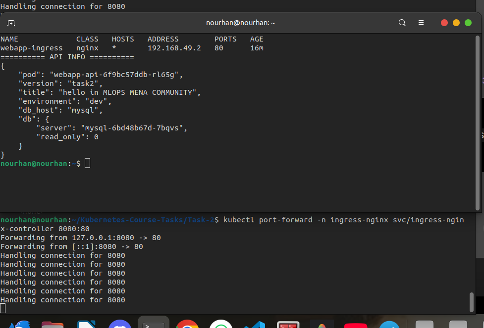
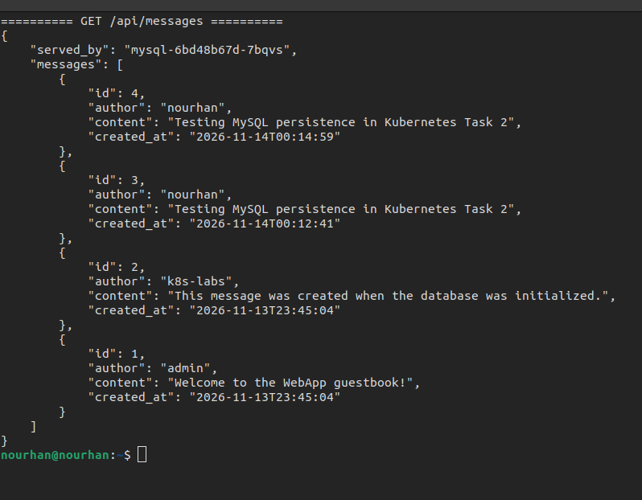
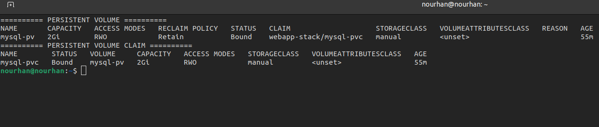
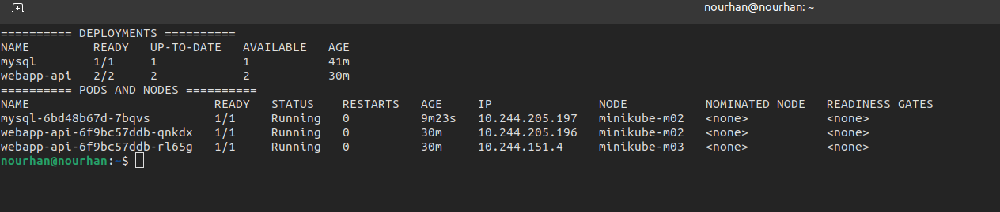
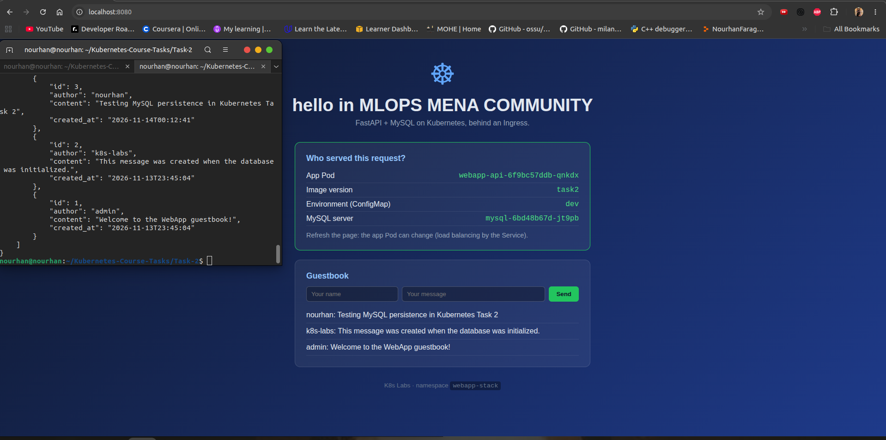
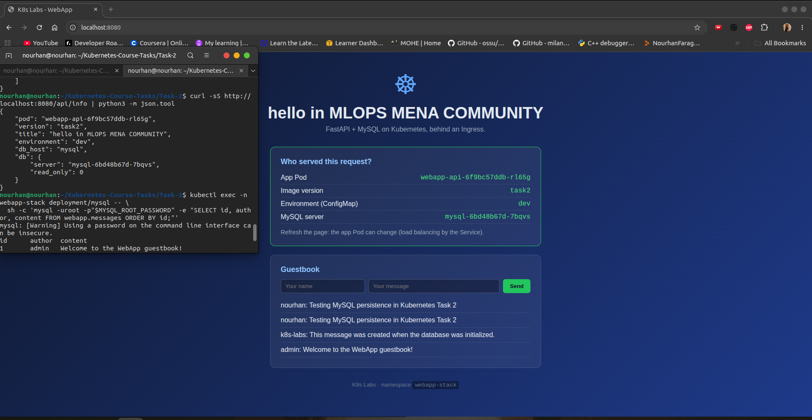

# Task 2 — FastAPI + MySQL on Kubernetes

## Overview

This project deploys a multi-tier FastAPI guestbook application backed by a MySQL database on a three-node Minikube Kubernetes cluster.

The application demonstrates:

- Kubernetes Deployments and Services
- ConfigMaps for application configuration
- Secrets for database credentials
- PersistentVolumes and PersistentVolumeClaims
- Node affinity for node-local persistent storage
- NGINX Ingress for HTTP routing
- Database persistence after MySQL Pod deletion

The application uses the provided FastAPI and MySQL Dockerfiles from the MLOps MENA Community Kubernetes Course.

**Task source:** [Kubernetes Course Tasks — Session 2](https://github.com/MLOpsMENACommunity/Kubernetes-Course-Tasks/tree/master/task-session-2)

## Architecture

The application's request flow is:

Browser → NGINX Ingress Controller → webapp-ingress → webapp-api Service (80) → FastAPI Pods (8000) → mysql Service (3306) → MySQL Pod

MySQL stores its data through the following storage chain:

MySQL `/var/lib/mysql` → `mysql-pvc` → `mysql-pv` → `/data/webapp-mysql` on `minikube-m02`

### Kubernetes Resources

| Resource | Name | Configuration |
|---|---|---|
| Namespace | webapp-stack | Application namespace |
| ConfigMap | webapp-config | Application and database settings |
| Secret | mysql-secret | Database credentials |
| PersistentVolume | mysql-pv | 2Gi, hostPath, Retain |
| PersistentVolumeClaim | mysql-pvc | 2Gi, ReadWriteOnce |
| MySQL Deployment | mysql | 1 replica, Recreate |
| MySQL Service | mysql | ClusterIP, port 3306 |
| FastAPI Deployment | webapp-api | 2 replicas |
| FastAPI Service | webapp-api | ClusterIP, port 80 → 8000 |
| Ingress | webapp-ingress | NGINX, Prefix path / |

The PV uses node affinity to associate storage with `minikube-m02`.

## Prerequisites

- Ubuntu 22.04
- Docker
- Minikube
- kubectl
- Git
- curl
- A working three-node Minikube cluster, including the node `minikube-m02`

## Deployment Instructions

Run the following commands from the `Task-2/` directory unless otherwise specified.

### 1. Start Minikube

`minikube start -p minikube`

Verify the cluster:

`kubectl get nodes -o wide`

All three nodes should report `Ready`.

### 2. Build the Docker images

First, configure the provided MySQL initialization script:

`chmod -x mysql/initdb/01-setup.sh`

Build the two images:

`docker build -t webapp-api:task2 ./webapp`

`docker build -t webapp-mysql:task2 ./mysql`

Load the images into Minikube:

`minikube image load webapp-api:task2`

`minikube image load webapp-mysql:task2`

Verify:

`minikube image ls`

Both images should appear with the `task2` tag.

### 3. Create the Namespace

`kubectl apply -f manifests/01-namespace.yaml`

Verify:

`kubectl get namespace webapp-stack`

### 4. Configure the Secret

A safe Secret template is provided at:

`manifests/02-mysql-secret.example.yaml`

Create a local manifest:

`cp manifests/02-mysql-secret.example.yaml manifests/02-mysql-secret.yaml`

Edit `manifests/02-mysql-secret.yaml` and replace the password placeholders with the credentials specified in the assignment.

Apply the Secret:

`kubectl apply -f manifests/02-mysql-secret.yaml`

Verify:

`kubectl get secret mysql-secret -n webapp-stack`

The Secret should contain three keys.

**Security note:** The real Secret manifest is excluded from Git using `.gitignore`. The example file contains placeholders and is safe to commit. The classroom credentials must not be reused in production.

### 5. Create the ConfigMap

`kubectl apply -f manifests/03-webapp-config.yaml`

The ConfigMap provides:

| Variable | Value |
|---|---|
| APP_TITLE | hello in MLOPS MENA COMMUNITY |
| APP_ENV | dev |
| MYSQL_HOST | mysql |
| MYSQL_PORT | 3306 |
| MYSQL_DATABASE | webapp |

Verify:

`kubectl get configmap webapp-config -n webapp-stack`

### 6. Create Persistent Storage

`kubectl apply -f manifests/04-mysql-pv.yaml`

`kubectl apply -f manifests/05-mysql-pvc.yaml`

Storage configuration:

- Capacity: 2Gi
- Access mode: ReadWriteOnce
- Storage class: manual
- Reclaim policy: Retain
- hostPath: `/data/webapp-mysql`
- Required node: `minikube-m02`

Verify:

`kubectl get pv mysql-pv`

`kubectl get pvc mysql-pvc -n webapp-stack`

Both resources should show `Bound`.

### 7. Deploy MySQL

`kubectl apply -f manifests/06-mysql-deployment.yaml`

`kubectl apply -f manifests/07-mysql-service.yaml`

The Deployment runs a single MySQL replica with the `Recreate` strategy and mounts the PVC at `/var/lib/mysql`.

Verify:

`kubectl rollout status deployment/mysql -n webapp-stack`

`kubectl get pods -n webapp-stack -l app=mysql -o wide`

The MySQL Pod must run on `minikube-m02`.

### 8. Deploy FastAPI

`kubectl apply -f manifests/08-webapp-deployment.yaml`

`kubectl apply -f manifests/09-webapp-service.yaml`

The FastAPI Deployment has two replicas. Configuration values are injected from `webapp-config`, and database credentials come from `mysql-secret`.

Verify:

`kubectl rollout status deployment/webapp-api -n webapp-stack`

`kubectl get deployments -n webapp-stack`

Expected ready replicas:

- MySQL: 1/1
- FastAPI: 2/2

### 9. Enable the Ingress Controller

`minikube addons enable ingress`

Verify:

`kubectl get pods -n ingress-nginx`

`kubectl get ingressclass`

The NGINX Controller should be Running, and an IngressClass named `nginx` should exist.

### 10. Create the Ingress

`kubectl apply -f manifests/10-webapp-ingress.yaml`

The Ingress routes requests on path `/` to the FastAPI Service on port 80.

Verify:

`kubectl describe ingress webapp-ingress -n webapp-stack`

### 11. Access the Application

Start port forwarding to the Ingress Controller:

`kubectl port-forward -n ingress-nginx svc/ingress-nginx-controller 8080:80`

Keep this terminal open.

Open the application in a browser:

**http://localhost:8080/**

The application exposes:

| Endpoint | Method | Description |
|---|---|---|
| / | GET | Guestbook homepage |
| /health | GET | Application health |
| /api/info | GET | Application and database information |
| /api/messages | GET | Read guestbook messages |
| /api/messages | POST | Submit a new guestbook message |

The Ingress Controller routes HTTP requests to the FastAPI Service, which forwards traffic to one of the two application Pods.

## Verification and Results

### Application Configuration

The `/api/info` endpoint was tested successfully through Ingress.

Confirmed values:

- Version: `task2`
- Title: `hello in MLOPS MENA COMMUNITY`
- Environment: `dev`
- Database host: `mysql`
- MySQL server: reachable and writable

### Guestbook Messages

The `/api/messages` endpoint successfully returned the two default messages created during MySQL initialization.

Two additional test messages were submitted using the author `nourhan` and the content:

*Testing MySQL persistence in Kubernetes Task 2*

The API successfully returned the stored messages.

### PersistentVolume and PersistentVolumeClaim

Both storage resources were successfully bound:

- PV: `mysql-pv`
- PVC: `mysql-pvc`
- Capacity: 2Gi
- Storage class: manual
- Status: Bound

### Deployments and Pods

The Kubernetes cluster successfully ran:

- One MySQL Pod on `minikube-m02`
- Two FastAPI Pods across the worker nodes

The MySQL Deployment reached 1/1 Ready, and the FastAPI Deployment reached 2/2 Ready.

## MySQL Persistence Test

The primary goal of this test was to confirm that guestbook data survives MySQL Pod deletion.

### Before Deletion

Messages were successfully inserted into MySQL through the FastAPI guestbook.

The original database Pod was:

`mysql-6bd48b67d-jt9pb`

### Delete the MySQL Pod

The following command deleted the MySQL Pod:

`kubectl delete pod -n webapp-stack -l app=mysql`

Because the MySQL Deployment maintains one replica, Kubernetes automatically created a replacement Pod.

### After Deletion

The replacement Pod was:

`mysql-6bd48b67d-7bqvs`

The new Pod ran on `minikube-m02` and reused the existing persistent storage.

The `/api/info` endpoint reported the new MySQL Pod name, confirming that FastAPI successfully connected to the replacement database server.

The `/api/messages` endpoint and a direct MySQL query confirmed that all four messages were still present.

The PV and PVC remained `Bound`.

### Persistence Result

**Passed — No guestbook messages were lost during the MySQL Pod replacement.**

The result demonstrates that data stored through the PVC is independent of the MySQL Pod lifecycle, provided the underlying persistent storage remains available.

## Key Learnings

1. Kubernetes Deployments maintain the requested number of Pods and recreate Pods after deletion.
2. Services provide stable internal DNS names even when Pod IP addresses change.
3. ConfigMaps externalize non-sensitive application settings.
4. Secrets provide credentials to containers without hardcoding them in Deployment manifests.
5. PersistentVolumes and PVCs allow MySQL data to survive Pod replacement.
6. Node affinity ensures a Pod using node-local storage is scheduled on the appropriate node.
7. NGINX Ingress routes external HTTP requests to an internal Kubernetes Service.
8. Readiness and liveness probes help Kubernetes monitor application health.

## Notes and Limitations

This project uses a `hostPath` PersistentVolume for educational purposes. The storage is tied to `minikube-m02`, so it is not a highly available database storage solution.

The 2Gi PV capacity is declarative and does not enforce a filesystem quota for `hostPath`.

The community ingress-nginx controller is used to satisfy this course lab's requirements; it is retired and should not be adopted for new production deployments.

The MySQL credentials are classroom examples. Sensitive values should be managed with proper security controls in production.

## Conclusion

Successfully deployed a FastAPI guestbook backed by MySQL on a three-node Kubernetes cluster using ConfigMap, Secret, PV/PVC, Services, and NGINX Ingress.

Validated HTTP routing, database connectivity, multiple FastAPI replicas, and persistent MySQL data after Pod deletion.
